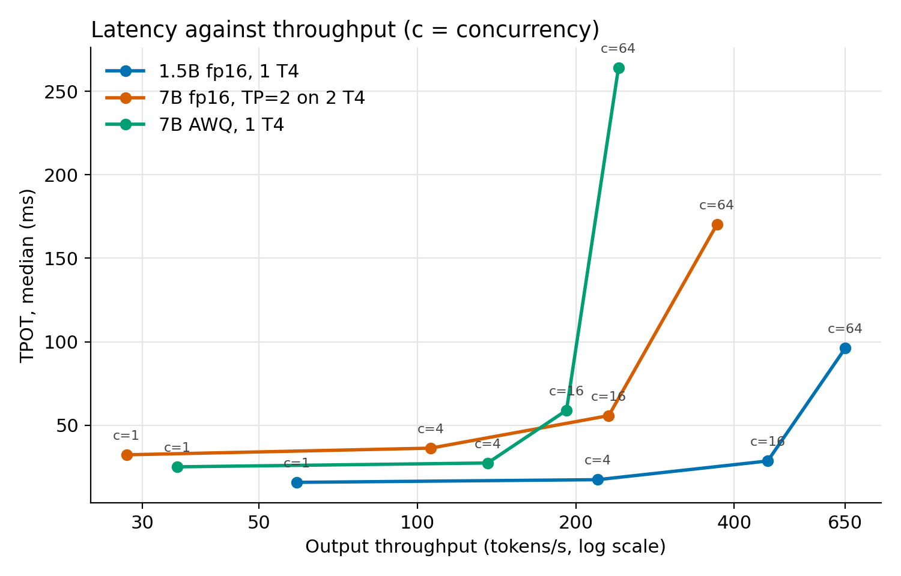

# gpu-experiments

Small LLM inference experiments on free Kaggle Tesla T4 GPUs, measured with vLLM.
I did them while I prepared for the NVIDIA NCA-AMAD certification.
Each experiment follows one method: predict the result with simple math, measure it, then explain the gap.

## Key findings

- The KV cache size matched the per-token formula exactly. One token takes 28,672 bytes for Qwen2.5-1.5B, and 335,872 tokens fill 8.97 GiB, as vLLM reported. (KV cache: the stored attention keys and values of past tokens.)
- At low load, decode is limited by memory bandwidth. The 1.5B model read 3.1 GB of weights per token. The T4 floor is about 9.7 ms. The measured TPOT was 15.7 ms. (TPOT: time per output token.)
- Batching is cheap. From 1 to 4 concurrent requests, throughput grew 3.7 times and TPOT grew only 10%.
- The 7B model in 4-bit AWQ on one T4 had a lower TPOT than 7B fp16 on two T4s: 25.0 ms against 32.2 ms at concurrency 1. Two T4s gave more throughput at concurrency 64: 371 tokens/s against 241. (AWQ: 4-bit weight quantization. Tensor parallelism, or TP: one model split over several GPUs.)
- GSM8K scored 91 of 100 for fp16 and 90 of 100 for AWQ. The standard error is about 3 points, so this run shows no quality difference.
- Prefix caching cut the median TTFT 10 times on prompts that share a 2,000-token prefix. N-gram speculative decoding made a copy task 4 times faster at concurrency 1 and 2.1 times faster at concurrency 16.
- Under a 2 s TTFT p99 SLA, 500 users need 3 T4s on the 1.5B model, 8 on 7B AWQ and 14 on 7B with tensor parallelism. The latency target, not raw throughput, sets the count.
- In RAG over 87 NVIDIA articles, a cross-encoder reranker lifted recall@1 from 0.62 to 0.81 for 130 ms per query. BM25 beat dense retrieval, but the synthetic questions reuse passage words, which favours keyword search.
- QLoRA on Qwen2.5-0.5B took 5.8 minutes on one T4 and lifted news-label accuracy from 0.62 (4-shot prompt) to 0.89, with every reply valid JSON. A 50-question GSM8K probe showed no forgetting.
- In vLLM, the LoRA adapter and the merged model scored the same (0.87 on 100 items). The adapter request took 169 ms, the merged model 53 ms and the plain base 55 ms. The adapter is 34 MiB per task and the merged model is 953 MiB.
- RAPIDS cuDF ran six pandas steps on 10 million rows 13.9 times faster than the CPU, with no code change. At 100 thousand rows three of the six steps were slower on the GPU.
- A data flywheel with 250 human labels per turn raised the app-specific score from 0.60 to 0.82 in three turns. When the model labelled its own failures, the score fell to 0.29.
- A 7B ReAct agent with tools passed 54% of 24 support tasks. One call with all data in the prompt passed 79%. The agent failed all 4 tasks that it must refuse.
- Against 12 prompt-injection attacks, only a code check before the tool runs stopped all of them. Prompt hardening stopped none of the 5 that worked.
- On Kubernetes, a readiness probe kept 800 requests free of errors while new pods loaded a model. Without it, 134 of 800 failed. Mesh outlier detection cut failures from a poisoned pod from 145 to 3 of 300.
- A cart-pole controller trained on one set of physics scored 1.00 in simulation and 0.14 on a hidden machine. Wide domain randomization scored 0.82 with no real data. An extra action delay of 50 ms cut success from 0.94 to 0.13, so control must run at the edge.
- NVIDIA Warp on a T4 ran 16,384 simulated machines 256 times faster than NumPy on the CPU. With one machine the same Warp kernel was 12 times faster on the CPU.
- On hosted Nemotron models, reasoning took arithmetic from 0.1 to 1.0 on a 30B MoE model and gave nothing on extraction and routing, at 9 to 105 times the tokens. A router kept the accuracy of the largest model with 94% less compute proxy (15 tasks).
- With the same model and GPU, vLLM gave 858 tokens/s at 16 requests against 31 for a simple one-request server. The client moved to a hosted NIM with no code change.
- Two hosted vision models could not tell possible motion from impossible motion better than a guess (24 clips). The same clips, question and seed at temperature 0 moved three of four scores by 7 to 18 points between two runs, and the critic picked from those scores went from useful to useless.
- Cosmos-Reason2-2B was not measurably better than its base model Qwen3-VL-2B at spotting impossible motion (120 clips, exact McNemar p between 0.47 and 1.0 on clips both answered). Post-training changed the behavior: with thinking, Cosmos called 34 of 77 clips impossible (19 right, 15 wrong) and the base called 0 of 98. Cosmos changed its verdict on 57% of the clips when only the wording changed.
- A PSI or KS alarm on the inputs fired 1 to 5 days after a covariate drift and almost never after a concept drift, where only the delayed labels showed the loss. A canary caught a feature-order bug that the offline test and the shadow test both passed.
- A naive feature join gave AUC 0.814 in validation and 0.577 at serving. The point-in-time join gave 0.673 and 0.607. (Point-in-time: each row uses only the values that existed at its time.)
- Kafka with a crash gave 50 duplicates (at-least-once) or 50 lost rows (at-most-once). An upsert sink made the result exact. A watermark must be as long as the late data: 1,800 s gave every window right and 900 s gave 11%.
- One agent was best or equal to three multi-agent designs, with the fewest tokens. A supervisor with parallel workers scored 0% on tasks where each step needs the one before. A memory store with no user scope gave another user's value in 80% of the questions.
- A 4B model with reasoning off beat a 30B model on office tasks (0.79 against 0.66). Forcing a JSON schema cut it to 0.57. An automatic prompt optimizer fitted its small dev set and gave nothing on held-out items.
- Ten looks at an A/B test with no real difference gave 20% false positives, not 5%. Chain of thought won offline by 0.09, but latency (4.5 times) and tokens (4.9 times) failed the guardrails.
- On two replicas, prefix-aware routing cut the TTFT p95 from 2.6 s to 1.4 s against round robin. Retries removed all 44 of 120 errors when a replica died, and a health check cut the wasted first tries from 72 to 3.
- One long prompt blocks every chat on the same GPU: the ITL p99 went from 33 ms to 4.9 s. Real prefill and decode disaggregation over NIXL on two T4s brought it back to 35 ms, but only 32 chats finished against 80, because the wait moved to the first token. (ITL: the gap between two tokens.)
- A pod with cached weights answered after 58 s and a pod that downloads them after 133 s. In a simulated spike, 2 warm standby pods took SLO violations from 56% to 0% for 10% more replica time.
- SFT on 1,500 code-made items took a 0.5B base model from 0.01 to 1.00 on its own instruction rules. DPO on pairs where the right reply is always the shorter one then lowered it to 0.90, and a reward model trained on the same pairs scored 0.00 on right-but-long against wrong-but-short. With balanced pairs it scored 0.83.
- GRPO took arithmetic from 0.00 to 1.00 in 15 minutes, partly by teaching the base model to write the answer line and to stop. A student distilled from a 1.5B teacher stayed at the teacher's level (0.56 to 0.61 against 0.55) and lost all of its GSM8K ability.
- An untrained end token made a whole set of fine-tunes look broken. LoRA does not train embeddings, so a base model whose end token was never trained cannot learn to stop on it.
- A digital twin of a motor gave an alarm 8.2 s before the raw sensor, with no false alarm on 30 machines. A policy that runs at the edge held 100% success up to 40 ms of delay, and fell to 57% at 50 ms and 0% at 70 ms.
- A pose network trained on one simulated look scored 100% at home and 0.4% on a second renderer. Domain randomization cut the error from 11.5 to 6.3 cm, and 40 labelled real images cut it to 1.4 cm. A first sampler that moved all colour channels together scored 0%, because its range never covered the test colours.
- On a table of 100,000 rows a random forest scored 90.8% and a neural network 86.1%. On CIFAR-10 the CNN scored 73.6% and hand-made HOG features with an SVM 49.8%. CLIP with no labels scored 89.3%, above every CNN trained with up to 1,000 labels per class.
- The CNN fell from 73.6% to 25.2% under noise and to 3.6% under a small adversarial step, and it stayed confident (calibration error 0.68). A planted shortcut dropped a tabular score from 95.2% to 59.5% when it was removed.
- The T4 beat all CPU threads in matrix multiply from n = 128, and from n = 512 when the copy to the GPU counts. A batch of 1 gave 1.7 times the CPU throughput and a batch of 4,096 gave 50 times.

## Charts

Each curve bends up when the GPU saturates. The 1.5B model gives the most throughput at the lowest latency.

The slowest 1% of requests wait much longer for a first token as load grows. (TTFT: time to first token.)
The high 1.5B point at concurrency 1 is a cold start: that run had no warm-up request, and the median there was 115 ms.

Weights take less space in AWQ, so one T4 keeps more room for KV cache.

Run `python scripts/make_charts.py` to rebuild the charts from `results/sweeps-2026-11-23.csv`.

## Experiments

| Notebook | Question | Result |
|---|---|---|
| `vllm-t4-serving-benchmark.ipynb` | How do TTFT, TPOT and throughput change with concurrency, and does the vLLM KV cache match the sizing math? | [Results](results/vllm-t4-serving-benchmark-2026-11-23.md) |
| `vllm-t4-7b-tensor-parallel-vs-awq.ipynb` | A 7B fp16 model does not fit on one T4. Is tensor parallelism on two T4s or AWQ on one T4 better for latency, throughput and accuracy? | [Results](results/vllm-t4-7b-tensor-parallel-vs-awq-2026-11-23.md) |
| `sizing-capacity-plan.ipynb` | How many T4 GPUs do 500 users need under a latency SLA? | [Results](results/sizing-capacity-plan-2026-11-23.md) |
| `vllm-t4-inference-optimizations.ipynb` | What do prefix caching, speculative decoding, chunked prefill and request queuing each change? | [Results](results/vllm-t4-inference-optimizations-2026-11-23.md) |
| `rag-chunking-hybrid-rerank.ipynb` | On a corpus of public NVIDIA articles, how do chunk size, BM25 vs dense vs hybrid search and a reranker change retrieval and groundedness? | [Results](results/rag-chunking-hybrid-rerank-2026-11-23.md) |
| `lora-qlora-finetune-t4.ipynb` | When does QLoRA fine-tuning beat prompting, how do overfitting and forgetting look, and how does adapter serving compare with a merged model? | [Results](results/lora-qlora-finetune-t4-2026-11-24.md) |
| `data-flywheel-cudf.ipynb` | How much does cuDF speed up data preparation, what does bad data cost, and does a data flywheel improve the application? | [Results](results/data-flywheel-cudf-2026-11-24.md) |
| `agent-react-guardrails.ipynb` | What does a multi-step agent buy over one LLM call, what does it cost, and which guardrail stops a prompt injection? | [Results](results/agent-react-guardrails-2026-11-24.md) |
| [`k8s-model-service/`](k8s-model-service/README.md) (GitHub Actions, no GPU) | How does Kubernetes keep a model service available while it crashes, updates and grows, and what does a service mesh add? | [Results](results/k8s-model-service-2026-11-24.md) |
| `sim-to-real-domain-randomization.ipynb` | How much do domain randomization and a sim-to-real flywheel close the gap, and why must the controller run at the edge? | [Results](results/sim-to-real-domain-randomization-2026-11-24.md) |
| `nim-model-selection.ipynb` | Which hosted Nemotron model should serve which workload, and when is reasoning worth its tokens? | [Results](results/nim-model-selection-2026-11-24.md) |
| `nim-three-backends.ipynb` | Can one client move between self-hosted and cloud, and how does private data stay off the cloud? | [Results](results/nim-three-backends-2026-11-24.md) |
| `cosmos-physical-check.ipynb` | Can hosted vision models tell possible motion from impossible motion? | [Results](results/cosmos-physical-check-2026-11-24.md) |
| `cosmos-reason2-vs-base-t4.ipynb` | Does physical-AI post-training make Cosmos-Reason2-2B better than its own base model at spotting impossible motion? | [Results](results/cosmos-reason2-vs-base-t4-2026-11-24.md) |
| `ops-observability-drift-lifecycle.ipynb` | Which monitor sees which drift, when should a model retrain, and what does a canary catch that a shadow test misses? | [Results](results/ops-observability-drift-lifecycle-2026-11-25.md) |
| `data-pipeline-batch-streaming-features.ipynb` | What do a GPU data pipeline, a feature store and a stream processor each change, and what does late data do? | [Results](results/data-pipeline-batch-streaming-features-2026-11-25.md) |
| `agents-memory-multi-agent.ipynb` | How do memory, retrieval, MCP, multi-agent routing and evaluation change an agent, and where do they fail? | [Results](results/agents-memory-multi-agent-2026-11-25.md) |
| `prompting-ab-test-productivity.ipynb` | Does an automatic prompt optimizer beat a hand-written prompt, and how many samples does an A/B test need? | [Results](results/prompting-ab-test-productivity-2026-11-25.md) |
| `serving-gateway-routing-disaggregation.ipynb` | How do batching, routing, failover, disaggregated prefill and decode, cold starts and autoscaling change a vLLM service? | [Results](results/serving-gateway-routing-disaggregation-2026-11-25.md) |
| `alignment-sft-dpo-kto-grpo.ipynb` | What data does each alignment method need, what does it change in a 0.5B model, and how does a reward model get hacked? | [Results](results/alignment-sft-dpo-kto-grpo-2026-11-25.md) |
| `models-classical-vision-parallel.ipynb` | When does a neural network beat a classical model, what do vision tasks return, and where does the GPU speed-up stop? | [Results](results/models-classical-vision-parallel-2026-11-25.md) |
| `digital-twin-openusd-newton.ipynb` | What is a digital twin good for, what does a scene in OpenUSD give you, and why must the policy run at the edge? | [Results](results/digital-twin-openusd-newton-2026-11-25.md) |

## How to run

1. Open a notebook in Kaggle: File, Import Notebook.
2. Open Settings, then Accelerator, and choose GPU T4 x2. These notebooks need no GPU: `sizing-capacity-plan`, `ops-observability-drift-lifecycle`, `data-pipeline-batch-streaming-features`, `agents-memory-multi-agent` and `prompting-ab-test-productivity`.
3. Turn Internet on.
4. Choose Run All.
5. Some notebooks call hosted NVIDIA models. Add `NVIDIA_API_KEY` as a Kaggle secret. The shared Kaggle address is throttled after about 1,000 calls, so run the call-heavy notebooks on a laptop.

Kaggle gives about 30 GPU hours each week for free.

## Setup

This table is for the two serving benchmarks.
The results file of each other experiment gives its own setup.

| Item | Value |
|---|---|
| GPU | Tesla T4, 15 GB, compute capability 7.5 (no bf16, so fp16) |
| Serving | vLLM 0.34.0 (V1 engine) |
| Framework | torch 2.14 with CUDA 13.0 (cu130) |
| Models | `Qwen/Qwen2.5-1.5B-Instruct`, `Qwen/Qwen2.5-7B-Instruct`, `Qwen/Qwen2.5-7B-Instruct-AWQ` |
| Load | `vllm bench serve`, random prompts, 512 input tokens, 128 output tokens |

## Limits

Each number comes from one run with one seed.
The samples are small: 16 to 256 requests per point and 100 GSM8K questions in the serving benchmarks, 101 synthetic questions in RAG, and 300 test items in QLoRA.
The two serving benchmarks use random prompts, so prefix caching does nothing there.
The load generator runs on the same machine, so there is no network latency.
The two-replica AWQ throughput in the results file is an estimate and not a measurement.

## License

MIT. See [LICENSE](LICENSE).
