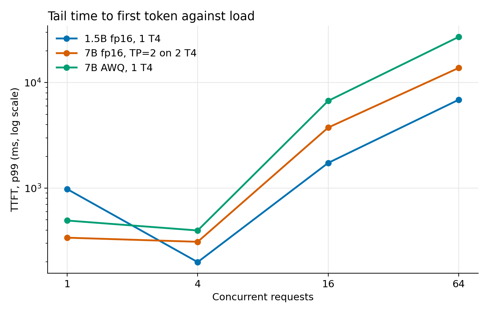
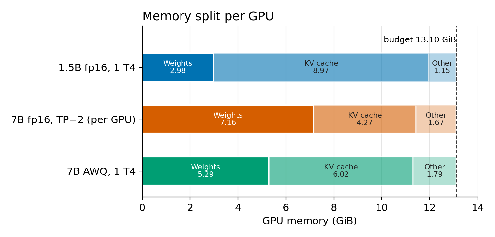

# gpu-experiments

Small LLM inference experiments on free Kaggle Tesla T4 GPUs, measured with vLLM.
I did them while I prepared for the NVIDIA NCA-AMAD certification.
Each experiment follows one method: predict the result with simple math, measure it, then explain the gap.

## Key findings

- The KV cache size matched the per-token formula exactly. One token takes 28,672 bytes for Qwen2.5-1.5B, and 335,872 tokens fill 8.97 GiB, as vLLM reported. (KV cache: the stored attention keys and values of past tokens.)
- At low load, decode is limited by memory bandwidth. The 1.5B model read 3.1 GB of weights per token. The T4 floor is about 9.7 ms. The measured TPOT was 15.7 ms. (TPOT: time per output token.)
- Batching is cheap. From 1 to 4 concurrent requests, throughput grew 3.7 times and TPOT grew only 10%.
- The 7B model in 4-bit AWQ on one T4 had a lower TPOT than 7B fp16 on two T4s: 25.0 ms against 32.2 ms at concurrency 1. Two T4s gave more throughput at concurrency 64: 371 tokens/s against 241. (AWQ: 4-bit weight quantization. Tensor parallelism, or TP: one model split over several GPUs.)
- GSM8K scored 91 of 100 for fp16 and 90 of 100 for AWQ. The standard error is about 3 points, so this run shows no quality difference.

## Charts

Each curve bends up when the GPU saturates. The 1.5B model gives the most throughput at the lowest latency.

The slowest 1% of requests wait much longer for a first token as load grows. (TTFT: time to first token.)
The high 1.5B point at concurrency 1 is a cold start: that run had no warm-up request, and the median there was 115 ms.

Weights take less space in AWQ, so one T4 keeps more room for KV cache.

Run `python scripts/make_charts.py` to rebuild the charts from `results/sweeps-2026-11-23.csv`.

## Experiments

| Notebook | Question | Result |
|---|---|---|
| `vllm-t4-serving-benchmark.ipynb` | How do TTFT, TPOT and throughput change with concurrency, and does the vLLM KV cache match the sizing math? | [Results](results/vllm-t4-serving-benchmark-2026-11-23.md) |
| `vllm-t4-7b-tensor-parallel-vs-awq.ipynb` | A 7B fp16 model does not fit on one T4. Is tensor parallelism on two T4s or AWQ on one T4 better for latency, throughput and accuracy? | [Results](results/vllm-t4-7b-tensor-parallel-vs-awq-2026-11-23.md) |
| `sizing-capacity-plan.ipynb` | How many T4 GPUs do 500 users need under a latency SLA? | Results pending |
| `vllm-t4-inference-optimizations.ipynb` | What do prefix caching, speculative decoding, chunked prefill and request queuing each change? | Results pending |

## How to run

1. Open a notebook in Kaggle: File, Import Notebook.
2. Open Settings, then Accelerator, and choose GPU T4 x2.
3. Turn Internet on.
4. Choose Run All.

Kaggle gives about 30 GPU hours each week for free.

## Setup

| Item | Value |
|---|---|
| GPU | Tesla T4, 15 GB, compute capability 7.5 (no bf16, so fp16) |
| Serving | vLLM 0.34.0 (V1 engine) |
| Framework | torch 2.14 with CUDA 13.0 (cu130) |
| Models | `Qwen/Qwen2.5-1.5B-Instruct`, `Qwen/Qwen2.5-7B-Instruct`, `Qwen/Qwen2.5-7B-Instruct-AWQ` |
| Load | `vllm bench serve`, random prompts, 512 input tokens, 128 output tokens |

## Limits

Each number comes from one run with one seed.
The samples are small: 16 to 256 requests per point, and 100 GSM8K questions.
Prompts are random, so prefix caching does nothing here.
The load generator runs on the same machine, so there is no network latency.
The two-replica AWQ throughput in the results file is an estimate and not a measurement.

## License

MIT. See [LICENSE](LICENSE).
